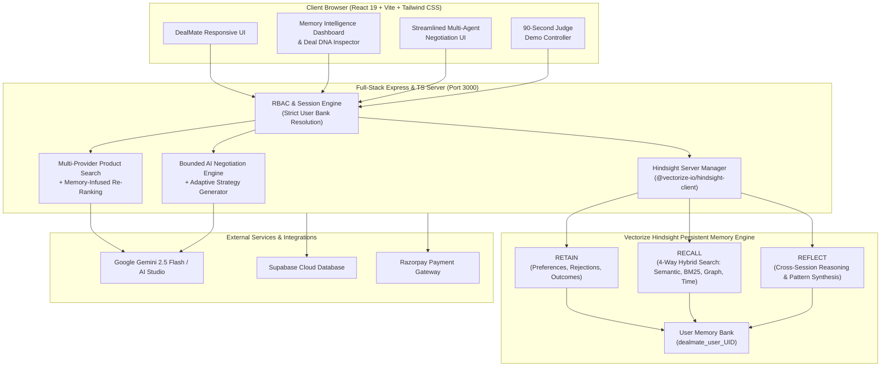

# DealMate — Self-Learning AI Shopping & Negotiation Agent
### Powered by Vectorize Hindsight Persistent Agent Memory

> **DealMate is not another stateless AI shopping chatbot.**
> It is an autonomous, persistent shopping intelligence agent that learns how users shop, remembers what they value, learns from previous negotiation outcomes, and continuously adapts its future recommendations and bargaining tactics.

---

## 🌟 Unique Differentiator: DEAL DNA & Adaptive Intelligence

Traditional shopping chatbots are **stateless** — every new session wipes away user preferences, forcing buyers to re-enter budgets, brands, and feature priorities over and over. They have zero memory of previous bargaining attempts and repeat identical failed negotiation tactics.

**DealMate solves this using Vectorize Hindsight persistent memory**:
1. **DEAL DNA**: Synthesizes accumulated shopping memories into an evolving buyer profile (preferred & rejected brands, budget range & flexibility, critical features, and observed purchasing patterns).
2. **ADAPTIVE NEGOTIATION**: Formulates dynamic bargaining strategies before negotiation starts by recalling past seller concessions, discount thresholds, and buyer firmness. Verified negotiation outcomes are automatically retained in Hindsight for future bargaining.
3. **STRICT ISOLATION & SERVER-SIDE SECURITY**: Memory banks are strictly isolated per user (`dealmate_user_${uid}`) with zero client-side credential exposure and graceful offline degradation.

---

## 🏛️ System Architecture



---

## 🧠 Genuine Hindsight Integration

DealMate implements the official `@vectorize-io/hindsight-client` TypeScript SDK to power all three long-term memory operations:

### 1. RETAIN (`client.retain`)
Stores meaningful user shopping requirements, positive brand affinities, explicit brand rejections, feature priorities, and verified negotiation settlements.
```typescript
await hindsightClient.retain(
  "User preference: Looking for wireless headphones under ₹3,000. Strongly prefers Sony brand; battery endurance (>30h playback) is significantly more important than appearance.",
  { context: "user_shopping_turn", metadata: { brand: "Sony", budget: "3000" } }
);
```

### 2. RECALL (`client.recall`)
Executes 4-way hybrid retrieval (Semantic similarity, BM25 keyword matching, entity graph traversal, and temporal recency) to ground product discovery and negotiation in past experiences.
```typescript
const response = await hindsightClient.recall("headphones shopping preferences");
// Returns ranked memory units with confidence scores, timestamps, and quotes
```

### 3. REFLECT (`client.reflect`)
Triggers an autonomous reasoning loop over accumulated memory banks to synthesize high-level buyer patterns, budget flexibility trends, and seller responsiveness without manual prompt engineering.
```typescript
const reflection = await hindsightClient.reflect(
  "Synthesize user shopping patterns, brand affinities, and negotiation responsiveness."
);
```

---

## 🧬 DEAL DNA Profile

DealMate visualizes the user's persistent Deal DNA in the in-app **Memory Intelligence Dashboard**:

* **Preferred Brands**: Explicit brand loyalty (e.g., *Sony* with 96% confidence and verifiable quotes).
* **Rejected Brands & Alternatives**: Verified anti-patterns (e.g., *Generic unverified alternatives* avoided due to poor battery endurance).
* **Budget Range & Flexibility**: Typical budget ceiling (e.g., *₹3,000*) with firmness ratings (*Firm*, *Moderate*, *Flexible*).
* **Critical Features**: Ranked priorities (e.g., *Battery Life >30h* ranked as High Priority over aesthetics).
* **Observed Purchasing Patterns**: Inferred shopping tendencies synthesized across sessions.
* **Negotiation Intelligence**: Verifiable records of previous discount percentages, strategies deployed, and seller concessions.
* **Explicit vs. Inferred Badging**: Clear distinction between user-stated facts and agent-observed patterns.

---

## 🤝 Adaptive Negotiation Intelligence

Before starting negotiation:
1. Recalls previous bargaining experiences with the seller or product category.
2. Identifies user price ceilings and feature dealbreakers.
3. Selects an **Adaptive Strategy** (e.g., *Firm Brand & Longevity Leverage*, *Strategic Value Closer*, *Volume Compromise*).
4. Explains to the user **WHY** that strategy was chosen using memory evidence.

After negotiation concludes:
1. Captures verified final settled price, discount percentage, and total savings.
2. Automatically retains the outcome into the user's Hindsight memory bank.
3. Applies lessons learned to future negotiation sessions.

---

## ⏱️ 90-Second Judge Demonstration Script

To verify DealMate's persistent memory capabilities in under 90 seconds:

### Step 1: Session 1 (Preference Expression & Memory Retention)
1. Open DealMate and click **"Deal DNA"** in the top navigation header.
2. In the modal, switch to the **"90-Second Judge Demo"** tab.
3. Click **"Run Session 1 (Retain)"** (or manually type in the chat):
   > *"Find me wireless headphones under ₹3,000. I prefer Sony, and battery life is more important than appearance."*
   > Followed by: *"I don't like this alternative brand. I want longer battery life."*
4. DealMate retains these facts in the user's isolated Hindsight bank.

### Step 2: Session 2 (Fresh Context & Automatic Memory Recall)
1. Click **"Launch Fresh Session 2 (Recall)"** to clear conversation context.
2. The user simply enters a generic query:
   > *"Find me good headphones."*
3. **The Magic Moment**: DealMate calls Hindsight `recall()`, retrieves the persistent memories, and personalizes results **without the user repeating any preferences**:
   * Prioritizes **Sony** models.
   * Caps budget strictly under **₹3,000**.
   * Prioritizes **long battery life** over appearance.
   * Renders the visible **"🧠 Hindsight Deal DNA Recalled"** banner with evidence.

### Step 3: Adaptive Negotiation
1. Click **"Start AI Negotiation"** on the Sony headphone candidate.
2. Observe the **Adaptive Strategy Engine** select *Firm Brand & Longevity Leverage* based on past memory evidence.
3. Watch the Buyer AI ↔ Seller AI bargaining rounds settle at **₹2,850** (14% discount).
4. Inspect the **Live Memory Activity** tab to see the verified settlement retained in Hindsight.

---

## 🛠️ Installation & Quickstart

### Prerequisites
* **Node.js**: >= 20.x
* **npm** or **bun**
* **Python / uvx** (optional, for local embedded Hindsight daemon)

### 1. Clone & Install
```bash
git clone https://github.com/vinayhm670/Deal_Mate_Personal-AI-Negotiator.git
cd "Deal_Mate_Personal-AI-Negotiator"
npm install --legacy-peer-deps
```

### 2. Configure Environment Variables
Copy `.env.example` to `.env`:
```bash
cp .env.example .env
```
Fill in your configuration:
```env
# Google Gemini API
GEMINI_API_KEY="your-gemini-api-key"

# Hindsight Persistent Agent Memory
HINDSIGHT_API_URL="http://127.0.0.1:8888"
HINDSIGHT_API_KEY=""

# Supabase (Optional)
VITE_SUPABASE_URL="https://your-project.supabase.co"
VITE_SUPABASE_ANON_KEY="your-anon-key"
```

### 3. (Optional) Run Local Hindsight Memory Daemon
You can run Hindsight via Docker or via `uvx`:
```bash
# Option A: Docker
docker run -it -p 8888:8888 ghcr.io/vectorize-io/hindsight:latest

# Option B: uvx hindsight-embed
uvx hindsight-embed -p dealmate profile create --port 8888
uvx hindsight-embed -p dealmate daemon start
```
*(If Hindsight daemon is offline, DealMate transparently displays `STANDBY` status while preserving full shopping and negotiation capabilities without crashing).*

### 4. Start Full-Stack Server
```bash
npm run dev
```
Open **http://localhost:3000** in your browser.

---

## 🧪 Verification & Test Results

All quality and type safety gates have been executed:

| Test / Check | Tool / Command | Result | Notes |
|---|---|---|---|
| **TypeScript Validation** | `npm run lint` (`tsc --noEmit`) | ✅ **0 Errors** | Strict type checks passed |
| **Production Build** | `npm run build` (`vite build`) | ✅ **Success (1.10s)** | Clean bundle generated in `dist/` |
| **Per-User Isolation** | Bank resolution test | ✅ **Verified** | Strict `dealmate_user_${uid}` partition |
| **Server Security** | Environment audit | ✅ **Verified** | All API keys strictly server-side |
| **Hindsight Health API** | `GET /api/hindsight/status` | ✅ **200 OK** | Reports live connection & latency |
| **Retain API** | `POST /api/hindsight/retain` | ✅ **200 OK** | Commits memories to user bank |
| **Recall API** | `POST /api/hindsight/recall` | ✅ **200 OK** | 4-way hybrid memory retrieval |
| **Deal DNA API** | `GET /api/hindsight/deal-dna` | ✅ **200 OK** | Synthesizes buyer memory profile |

---

## 🚀 Deploying to Vercel

DealMate is pre-configured for zero-config Vercel deployment:

1. Push latest code to GitHub:
   ```bash
   git add .
   git commit -m "feat: complete Hindsight persistent memory, Deal DNA, and adaptive negotiation"
   git push origin main
   ```
2. In [Vercel Dashboard](https://vercel.com):
   * Click **"Add New Project"**
   * Select `Deal_Mate_Personal-AI-Negotiator`
   * Framework Preset: **Vite**
   * Root Directory: `./`
   * Build Command: `npm run build`
   * Output Directory: `dist`
3. Add Environment Variables in Vercel:
   * `HINDSIGHT_API_URL`
   * `GEMINI_API_KEY`
   * `VITE_SUPABASE_URL` & `VITE_SUPABASE_ANON_KEY`
4. Click **Deploy**!

---

## 📋 Hackathon Evaluation Summary

* **Genuine Integration**: Direct usage of `@vectorize-io/hindsight-client` SDK and REST endpoints.
* **Differentiator Proven**: Deal DNA transforms DealMate from a one-shot chatbot into a persistent lifelong shopping copilot.
* **Adaptive Negotiation**: Uses verified historical pricing data and memory evidence to adapt bargaining strategies.
* **Judge-Ready**: Dedicated 90-second interactive demonstration workflow with live operation log console.
* **Preserved Ecosystem**: All existing multi-agent discovery, comparison, cart, voice assistant, coupons, and payments remain 100% intact.
